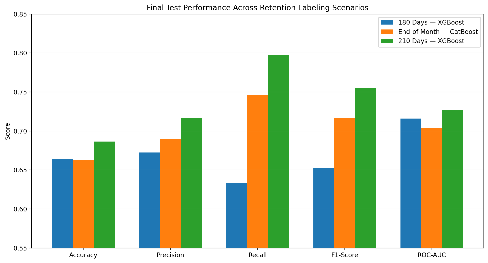
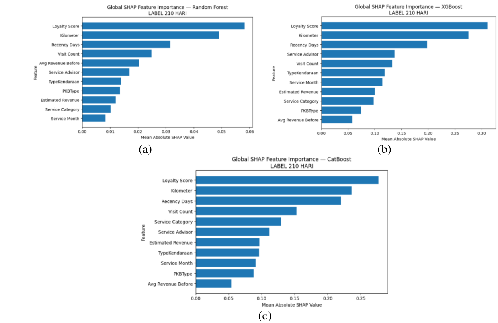
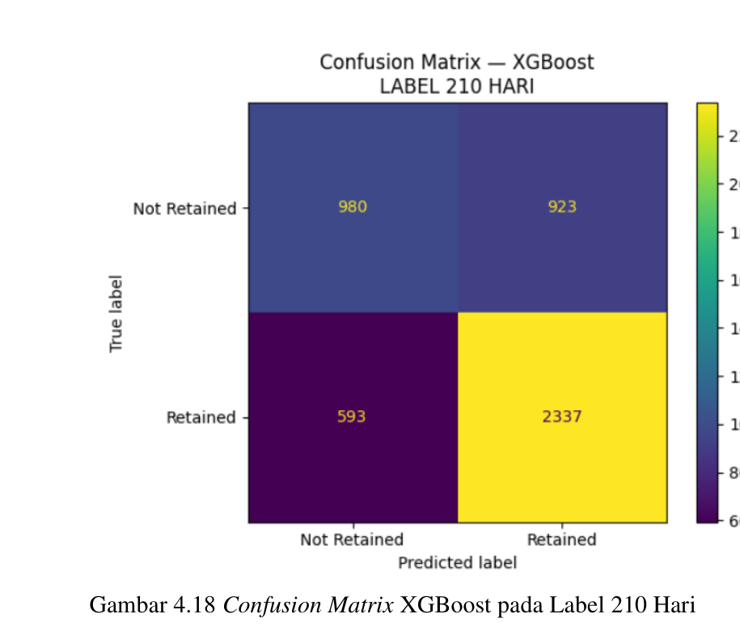

# Customer Retention Prediction | Automotive Aftersales

**Undergraduate thesis · Data Science Technology, Universitas Airlangga · Auto2000 Kenjeran (case study)**

A predictive analytics study of **when a vehicle returns for aftersales service**. I compared three definitions of a retained service visit and three tree-based classification algorithms to understand how the retention window affects customer-service monitoring and predictive performance.

> **Core finding:** The strongest tested configuration was **XGBoost under a 210-day retention definition** (test **F1-score 0.7551**, **ROC-AUC 0.7272**, **accuracy 0.6863**). The result supports evaluating an additional monitoring window after the standard 180-day service interval; it does **not** establish an improvement in actual retention or replace the official service schedule.

## 1. Business Problem

At Auto2000 Kenjeran, periodic aftersales reminders follow the T-Care interval of approximately **six months / 10,000 km**. Discussions with the Service Head and Maintenance Reminder & Appointment (MRA) team highlighted a practical challenge: vehicle usage and return-visit timing vary across customers. Some vehicles reach the mileage threshold sooner; others return after six months. A single fixed time boundary can therefore classify a delayed return differently from a visit made on schedule.

**Analytical question:** Can historical workshop transactions predict whether a vehicle will return for another service visit, and how does this prediction change when the operational retention definition includes a limited grace period?

This thesis focuses on **predictive model evaluation**, whereas the separate [Service Reminder Analytics](https://github.com/kabsyahr/service-reminder-analytics) project focuses on reminder scheduling and operational follow-up actions.

## 2. Data Sources and Scope

- **Source:** Internal **Proses Kerja Bengkel (PKB)** workshop service transactions from **Auto2000 Kenjeran**, covering **1 November 2023–22 December 2025**.
- **Original structure:** **26 monthly Excel sheets**, integrated and cleaned in Python; the final notebooks report **43,984 integrated rows** across 18 source columns before analytical selection.
- **Unit of analysis:** One **service transaction / vehicle observation**, **not** a unique customer. A vehicle can appear in several historical transactions.
- **Original candidate predictors (6):** `PKBType`, `Service Category`, `TypeKendaraan`, `Service Advisor`, `Kilometer`, and `Estimated Revenue`.
- **Supporting fields:** Transaction number, service date and vehicle identifier supported chronological sorting, retrospective label creation and historical feature engineering. These identifiers were not used directly as predictive features.
- **Scope:** Selected workshop service categories and booking, walk-in and field-service transaction types. Only transactions with a fully observable retention window were included in each scenario.

**Confidentiality:** The original PKB data contain internal and vehicle-level information and are not distributed in this repository. The accompanying notebooks and any rendered outputs should be checked for exposed identifiers before publication.

## 3. Retention Definition: Three Business Scenarios

For each transaction, the label indicates whether **the same vehicle** returned for another recorded service visit before the applicable deadline:

| Scenario | Label `retained = 1` when the next visit occurs… | Eligible observations | Retained share |
|---|---|---:|---:|
| **180 days** | Within 180 days after the transaction | 33,842 | 49.73% |
| **End-of-month** | By the end of the month containing the 180-day deadline | 32,651 | 57.13% |
| **210 days** | Within 210 days after the transaction (an additional 30 days) | 32,216 | 60.63% |

The end-of-month grace period varies with the transaction date; the 210-day extension is fixed. A different cutoff date was applied to each scenario to avoid labeling recent transactions as non-retained before the outcome window had elapsed.

**Interpretation:** A vehicle returning on day 198 is non-retained under the 180-day definition but can count as retained under the end-of-month or 210-day definitions, depending on the calendar date. These definitions are alternative **analytical labels**, not new company T-Care eligibility rules.

## 4. Analytical Workflow

**Integrate monthly PKB records → Clean and filter → EDA → Define three retention labels → Engineer historical features → Stratified train/validation/test split → Model-specific preprocessing → SHAP-based feature ranking → Feature selection and Optuna tuning → Validation-based model selection → Held-out test evaluation → Error analysis.**

### Feature engineering

The study created **five features** from earlier service records, added to the six original predictors (**11 candidate features in total**):

| Feature | Meaning |
|---|---|
| `Visit Count` | Cumulative number of recorded service visits through the current transaction |
| `Recency Days` | Days since the preceding service transaction; `-1` for the first recorded visit |
| `Loyalty Score` | Visit intensity normalized by the observed history length: `Visit Count / (tenure_days / 365 + 1)` |
| `Avg Revenue Before` | Mean estimated service revenue from **preceding** transactions only; `0` when no previous visit exists |
| `Service Month` | Calendar month of the current service transaction (categorical) |

Historical features were designed around information available through the transaction being predicted, not the next visit used to derive its label.

### Model development and evaluation

- **Models:** Random Forest, XGBoost, CatBoost.
- **Categorical processing:** Target encoding for Random Forest; native categorical handling for XGBoost and CatBoost, as described in the final thesis.
- **Split:** Stratified **70% train / 15% validation / 15% test**, randomly sampled at **transaction-row level**.
- **Feature selection:** Global SHAP importance ranked candidate features. Rankings across models were combined using arithmetic mean, median, geometric mean and L2 norm; **Top-1 through Top-11** feature subsets were evaluated.
- **Optimization:** Optuna TPE with **30 trials** per configuration and **stratified five-fold cross-validation**, minimizing **mean CV log loss**.
- **Selection:** Validation-set comparison across accuracy, precision, recall, F1-score and ROC-AUC; final assessment on held-out test data, plus confusion matrices and false-positive / false-negative SHAP analysis.

## 5. Results: Held-Out Test Performance

| Retention definition | Selected model | SHAP rank aggregation | Features | Accuracy | Precision | Recall | F1-score | ROC-AUC | Log loss |
|---|---|---|---:|---:|---:|---:|---:|---:|---:|
| 180 days | XGBoost | L2 norm | 11 | 0.6642 | 0.6724 | 0.6333 | 0.6523 | 0.7160 | 0.6160 |
| End-of-month | CatBoost | Median | 10 | 0.6631 | 0.6894 | 0.7466 | 0.7169 | 0.7033 | 0.6162 |
| **210 days** | **XGBoost** | **Median** | **11** | **0.6863** | **0.7169** | **0.7976** | **0.7551** | **0.7272** | **0.5898** |

For **XGBoost at 210 days**, the test set contained **4,833 transactions**. The confusion matrix recorded **TN = 980, FP = 923, FN = 593, TP = 2,337**, with **retained** as the positive class.

**Important comparison caveat:** The three scenarios change both the outcome definition and the set of eligible transactions; better 210-day metrics therefore **do not prove that extending the operational reminder schedule improves retention**. They show the highest test metrics **for the corresponding analytical task and dataset**.

### Result visualizations



*Selected-model metrics under three different retention-labeling definitions.*



*Global feature importance from the 210-day analysis; importance reflects model attribution, not causal influence.*



*Confusion matrix with the retained class as positive.*

## 6. Analytical Findings and Business Implications

| Observed finding | Why it matters | Evidence-based implication |
|---|---|---|
| **Retained share rises from 49.73% (180 days) to 60.63% (210 days)** | Some recorded repeat visits occur after the original six-month deadline | Review late-returning vehicles as a separate monitoring segment instead of interpreting every day-181 return as permanently lost |
| **The selected 210-day XGBoost model has the highest reported test F1 and ROC-AUC** | Retention definitions affect class balance, sample eligibility and predictive results | Select the prediction horizon according to the operational decision being supported, not solely the largest score |
| **Loyalty Score, Recency Days and Kilometer have consistently high SHAP importance; Visit Count is also important** | Visit intensity, service gaps and vehicle usage contain predictive information | Prioritize testing history-based signals when developing an aftersales monitoring model; do not interpret SHAP as proof of causality |
| **False positives and false negatives remain substantial** | Predictions cannot reliably replace customer-status verification | Treat scores as decision support, with human follow-up and outcome tracking |

**Error trade-off:** On the 210-day test set, **923 actual non-retained observations** were predicted retained (false positives), while **593 actual retained observations** were predicted non-retained (false negatives). If the model is later used for outreach prioritization, teams must explicitly decide which type of error is more costly.

## 7. Recommended Operational Actions (Proposals, Not Measured Outcomes)

1. **Keep the formal T-Care service deadline separate from predictive monitoring.** Use 180 days as an existing service reference, and explore a **day-181 to day-210 follow-up segment** for late-returning vehicles without representing that period as an extension of program benefits.
2. **Pilot a validation-only priority list.** Combine model probabilities with verified service history and existing eligibility rules; let MRA/CRC review the list rather than automatically treating a model output as a confirmed churn status.
3. **Track actual outcomes and capacity.** Measure outreach attempts, successful contacts, bookings, completed service visits and late returns by score band; compare against a documented baseline before claiming an operational benefit.
4. **Review prediction mistakes.** Examine false positives and false negatives by service history and category to assess whether outreach priorities need better data or a different classification threshold.

## 8. Limitations and Future Work

- **Single-branch data:** Returns to other Auto2000 branches may not appear in the observed workshop history.
- **Transaction-row random split:** Repeated observations of the same vehicle can occur across train, validation and test partitions. Future evaluations should include **vehicle-grouped and chronological holdouts** to assess performance for new vehicles and later periods more realistically.
- **Limited behavioral context:** Satisfaction, complaints, reminder response, ownership changes and cross-branch activity were not included as predictors.
- **Moderate discrimination:** ROC-AUC 0.7272 does not imply the model is production-ready or that outreach improves actual retention.
- **Future research:** Add relevant behavioral data, evaluate cross-branch transfer, test alternative model ensembles, assess probability calibration and business-oriented decision thresholds.

The thesis reports **research and offline test results**, not a production deployment, uplift experiment or measured increase in customer retention.

## 9. Technologies

Python, pandas, NumPy, scikit-learn, Random Forest, XGBoost, CatBoost, Optuna, SHAP, Matplotlib and Kaggle/Jupyter notebooks.

## 10. Repository and Reproducibility

```text
customer-retention-prediction/
├── README.md
├── customer_retention_prediction.ipynb
├── requirements.txt
└── images/
    ├── model_comparison.png
    ├── shap_feature_importance_210d.png
    └── confusion_matrix_210d.png
```

The public notebook documents the selected **210-day** modeling path; full comparisons also draw on separate final research notebooks for the **180-day** and **end-of-month** experiments. Re-running the original experiments requires approved access to the nonpublic PKB source and the associated execution environment. No company raw data are provided here.

---

**Source:** Final undergraduate thesis (2026), *Analisis Prediksi Retensi Pelanggan pada Layanan Aftersales Menggunakan Algoritma Tree Based (Studi Kasus: Toyota Auto2000 Kenjeran)*. Figures and result tables should be checked against their corresponding committed files before publication.
