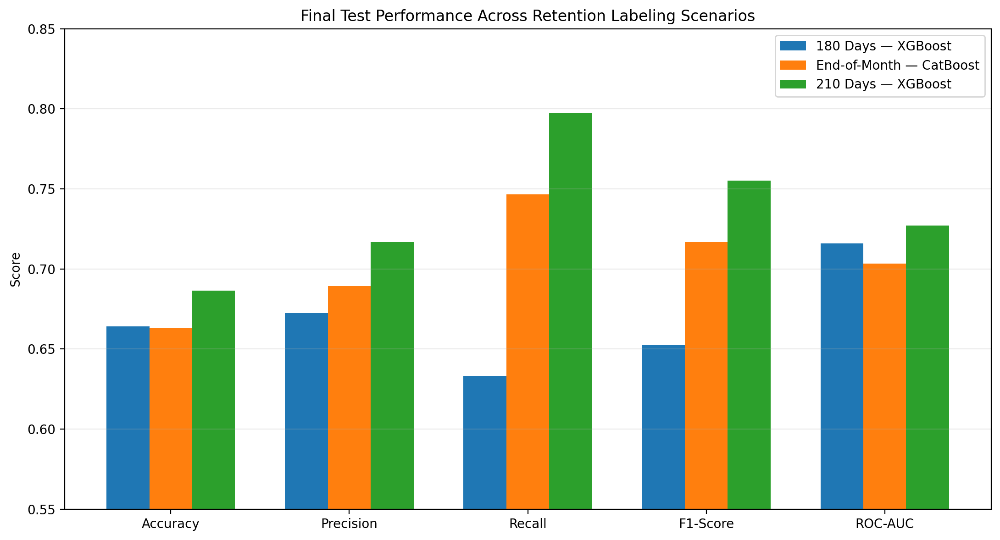
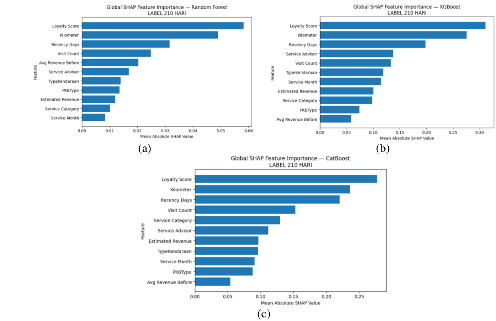
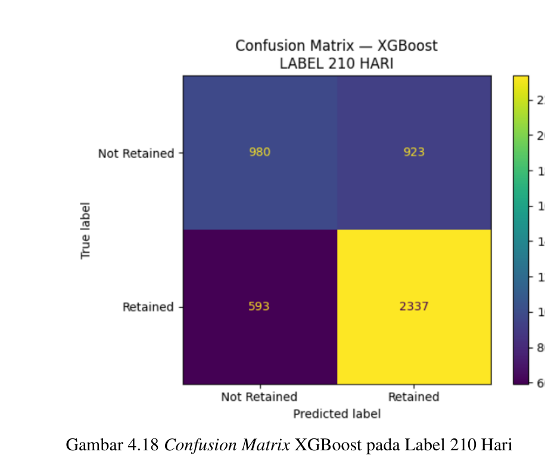

# Customer Retention Prediction

Customer retention prediction project developed as my undergraduate thesis at **Auto2000 Kenjeran**, focusing on automotive aftersales customer behavior using tree-based machine learning models.

The study compares multiple retention-labeling scenarios and evaluates **Random Forest, XGBoost, and CatBoost** to identify the strongest predictive approach for customer retention.

## Project Overview

Customer retention is an important aspect of aftersales performance because repeated service visits can reflect ongoing customer engagement with a workshop.

This project analyzes historical service transactions to predict whether customers are likely to return within predefined retention windows. The study evaluates three different labeling scenarios and compares multiple tree-based machine learning models.

The public notebook uses the **210-day labeling scenario** as the main modeling pipeline because it achieved the strongest overall test performance among the evaluated scenarios.

## Objectives

The project aimed to:

- Build customer retention labels using multiple time-window scenarios.
- Engineer behavioral and transactional features from historical service data.
- Compare Random Forest, XGBoost, and CatBoost.
- Identify important predictive features using SHAP.
- Optimize model hyperparameters using Optuna.
- Evaluate model performance using multiple classification metrics.
- Analyze prediction errors to better understand model behavior.

## Retention Labeling Scenarios

Three retention-labeling scenarios were evaluated:

- **180 Days**
- **End-of-Month**
- **210 Days**

Each scenario represents a different definition of whether a customer returned for another service visit within the specified retention period.

## Final Model Comparison

| Labeling Scenario | Best Model | Feature Aggregation | Top-K Features | Accuracy | F1-Score | ROC-AUC | Log Loss |
|---|---|---|---:|---:|---:|---:|---:|
| 180 Days | XGBoost | L2 Norm | 11 | 0.6642 | 0.6523 | 0.7160 | 0.6160 |
| End-of-Month | CatBoost | Median | 10 | 0.6631 | 0.7169 | 0.7033 | 0.6162 |
| **210 Days** | **XGBoost** | **Median** | **11** | **0.6863** | **0.7551** | **0.7272** | **0.5898** |

The **210-day scenario with XGBoost** produced the strongest overall performance among the three evaluated scenarios.

## Workflow

The project followed the analytical workflow:

**Data Integration → Data Cleaning & Filtering → Exploratory Data Analysis → Retention Labeling → Feature Engineering → Train/Validation/Test Split → Data Preprocessing → Feature Selection → Hyperparameter Tuning → Model Comparison → Final Evaluation → Error Analysis**

## Feature Engineering

Behavioral and transactional features were derived from historical service records, including:

- Visit Count
- Recency Days
- Loyalty Score
- Average Revenue Before
- Service Month

These features were combined with existing service-related variables to support customer retention prediction.

## Feature Selection

Feature selection was performed using **SHAP-based feature importance**.

Feature rankings from multiple evaluation components were aggregated, and different Top-K feature subsets were compared to identify the most effective feature configuration for each model and labeling scenario.

## Model Training

Three tree-based classification models were evaluated:

- Random Forest
- XGBoost
- CatBoost

Hyperparameter optimization was performed using **Optuna** with stratified cross-validation.

The models were evaluated using:

- Accuracy
- Precision
- Recall
- F1-Score
- ROC-AUC
- Log Loss

## Final Model

For the 210-day scenario, **XGBoost** achieved the best overall test performance:

- **Accuracy:** 0.6863
- **F1-Score:** 0.7551
- **ROC-AUC:** 0.7272
- **Log Loss:** 0.5898

## Results Visualization

### Final Test Performance Comparison

The final test results show that the **210-day labeling scenario with XGBoost** achieved the strongest overall performance across the three evaluated retention scenarios.



### SHAP Feature Importance — 210-Day Scenario

Global SHAP feature importance was used to identify the features with the highest contribution to model predictions in the 210-day scenario.



### Confusion Matrix — XGBoost 210-Day Scenario

The confusion matrix summarizes the final classification results of the selected XGBoost model on the 210-day test dataset.



## Tools & Technologies

- Python
- Pandas
- NumPy
- Scikit-learn
- XGBoost
- CatBoost
- Optuna
- SHAP
- Matplotlib
- Jupyter Notebook / Kaggle

## Repository Contents

```text
customer-retention-prediction/
├── README.md
├── customer_retention_prediction.ipynb
└── requirements.txt
```

## Notes

This repository is a portfolio version of my undergraduate thesis project.

Original company datasets, internal files, proprietary source data, and other confidential materials are not included in this public repository.
